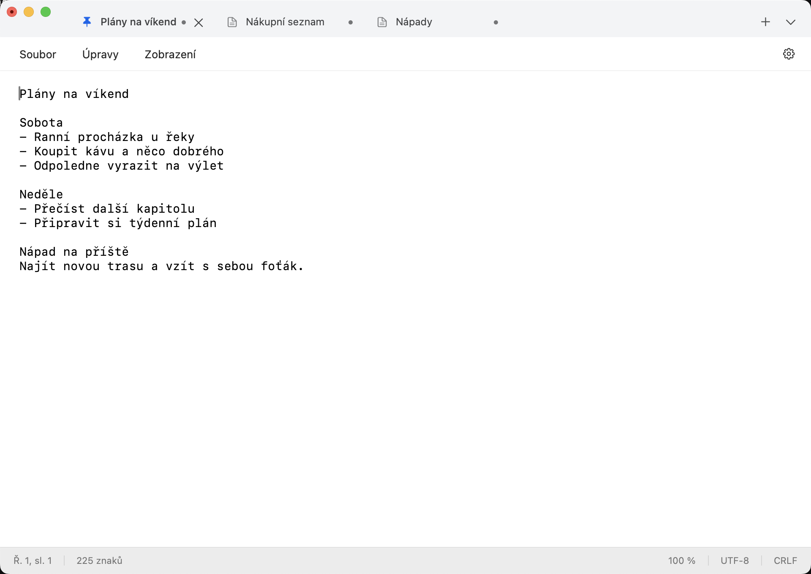
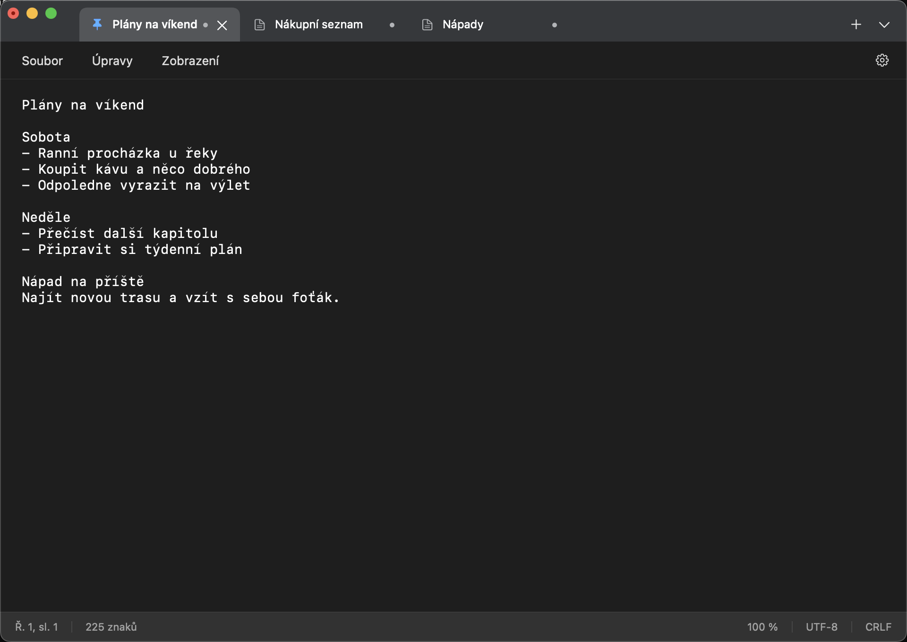

# MacPad

[](#requirements)
[](https://developer.apple.com/documentation/appkit)
[](#installation)
[](LICENSE)

> Native tabbed text editor for macOS with draft recovery, pinned notes and Windows 11 Notepad-style controls. Swift + AppKit, no external dependencies.



<details>
<summary>Dark mode</summary>



</details>

---

## Features

- 🗂️ **Tabbed notes** - New tabs, pinning, custom draft names, moving tabs between windows, reopening closed files
- ↔️ **Split editor** - Two editable panes with independent selection and scrolling; the same document shares text, identity and undo
- 📄 **Plain text files** - Open, Save, Save As, Save All; UTF-8, UTF-16 and Windows-1250 with encoding, BOM and line endings preserved
- 🖨️ **Files and printing** - Recent files, drag files into the editor and print through the system dialog, including Save as PDF
- 🔀 **Compare with disk** - Read-only versions with marked line differences; reload or overwrite only after checking that both versions are still current
- 🕘 **Saved version history** - Optional previous file versions, restored as new drafts; limited to 20 per file, 30 days and 100 MiB in total
- 💾 **Draft recovery** - Restores drafts, tab order, selection and scroll position after relaunch; recovery copies never touch the original file
- 🔍 **Search** - Find and replace in the current document, search across all open tabs and jump straight to a match
- 📝 **Markdown preview** - Read-only headings, lists, tasks and inline formatting beside the source, using the macOS Foundation parser
- ⌨️ **Keyboard navigation** - Tab switcher, command palette, macOS shortcuts and selected Windows-style Ctrl shortcuts
- ✂️ **Line operations** - Insert date/time, duplicate, move, sort and remove exact duplicates; all undoable
- 🎨 **Workspace** - Light, dark and system appearance, font, zoom, word wrap, line numbers, focus mode and always-on-top
- ⚡ **Quick note** - Compact window, optional menu bar item and configurable global shortcut; works only while MacPad is running
- 🌐 **Localization** - English and Czech UI

## Requirements

- macOS 15.7.4 on Apple Silicon is verified; macOS 14 remains untested
- Intel is not supported by the arm64 package
- Xcode 26.3 and [XcodeGen](https://github.com/yonaskolb/XcodeGen) 2.44.1 for building
- No runtime dependencies beyond AppKit, Foundation, CryptoKit and Carbon

## Installation

MacPad is in development (0.1.0). A signed and notarized release is not published yet, so build it from source:

```sh
git clone https://github.com/nks-hub/nks-macpad.git
cd nks-macpad
bash scripts/build.sh build
open build/DerivedData/Build/Products/Debug/MacPad.app
```

XcodeGen must be in `PATH`, or set `XCODEGEN` to its executable. The script generates the project from `project.yml`; the generated `MacPad.xcodeproj` and build output are not tracked in Git.

Bundle identifiers: `com.nkshub.macpad` (app) and `com.nkshub.macpad.core` (shared framework).

## Usage

### Keyboard shortcuts

| Action | Shortcut |
|--------|----------|
| New tab / new window | ⌘N or ⌘T / ⇧⌘N |
| Open / Save / Save As | ⌘O / ⌘S / ⇧⌘S |
| Save All | ⌥⌘S |
| Close tab / window | ⌘W / ⇧⌘W |
| Find / Replace | ⌘F / ⌥⌘F |
| Find in all tabs | ⇧⌘F |
| Tab switcher / command palette | ⌘K / ⇧⌘P |
| Reopen closed file | ⇧⌘T |
| Undo / Redo | ⌘Z / ⇧⌘Z |
| Print | ⌘P |

Ctrl aliases work inside the editor and do not override the system keyboard. The quick note global shortcut is off until you set it.

Enable the menu bar icon in **Settings → Recovery and shortcuts**. Clicking it opens the same quick note each time; Escape saves its recovery snapshot, hides the window and returns focus to the previous app. macOS may hide the icon when the menu bar is full; the global shortcut and command palette remain available.

Use **View → Split editor** to open a second pane. Each pane has a document selector; tabs and commands act on the pane marked active. **View → Switch editor pane** moves focus between them. Escape closes the Markdown preview first, if open, then the split. Split layout is temporary; relaunch restores documents and the last active document's cursor.

The Open dialog includes an encoding selector and a text preview. Automatic mode reads a BOM or strict UTF-8. Choose UTF-16 LE/BE for files without a BOM, or Windows-1250 for legacy text. Invalid input prompts for an encoding before opening; a BOM takes precedence over the selection.

## Saving and Privacy

- Files on disk change only after an explicit save. If another program modifies an open file, MacPad reports the conflict; a change during the atomic replace is kept in a separate copy and its path is shown.
- **File → Compare with file on disk** shows both versions, line numbers, changed lines, encoding and line endings. A stale comparison must be refreshed before reloading or overwriting. Save a copy remains available; there is no automatic merge.
- Drafts live in `~/Library/Application Support/MacPad`. They are not encrypted. Recovery can be turned off in Settings; discarding a draft removes it from both recovery copies.
- Saved version history is off by default. Enable it in **Settings → History** and open it from **File → Saved version history**. It stores previous file bytes in the local `History` subfolder without encryption. Limits are applied at launch, when saving and when opening history. Delete one file's history from the File menu or all history from Settings; turning recording off keeps existing versions. Discarded unsaved edits are never archived.
- **View → Markdown preview** leaves the source unchanged. HTML is shown as text and images as labels; neither loads resources. Only HTTP/HTTPS links are clickable, and they open the system browser after a click. The preview uses Foundation and AppKit without a web view or an additional parser dependency.
- No account, no cloud sync, no telemetry. Saving into a synced folder works, but concurrent edits can still conflict.

## Testing

```sh
bash scripts/build.sh test
CONFIGURATION=Release bash scripts/build.sh test
```

Revision `fe9675e` passed 139 automated tests on macOS 15.7.4 in Release: 48 for the file layer, recovery, history and line comparison, 91 for AppKit, lifecycle, split editing, Markdown, printing and performance. GUI checks also cover PDF output, the menu bar quick note and keyboard control of focus mode and always-on-top with VoiceOver. On an Apple M1 Pro, opening a 50 MiB file with short ASCII lines takes 743 ms (median) and inserting a character at the end 8 ms; in a 10 MiB file of Czech text the insert takes 24 ms. Details and measurement limits are in [docs/VALIDATION.md](docs/VALIDATION.md).

Set `MACPAD_SESSION_DIR` to a separate folder for isolated test runs. Do not use real personal notes as test data.

`bash scripts/release.sh --help` describes release packaging. It requires a Developer ID Application identity in `SIGN_IDENTITY` and a notarytool keychain profile in `NOTARY_PROFILE`. The script builds a clean Git revision for Apple Silicon, signs and notarizes it, checks Gatekeeper, then places a ZIP, SHA-256 checksum and revision manifest in `dist`. It does not publish a release. Version 0.1.0 from `3206e99` passed signing, notarization, quarantined launch and replacement of an earlier development build on macOS 15.7.4. That package predates the printing fix. Remaining release gates are tracked in [TODO.md](TODO.md), including complete VoiceOver acceptance, physical keyboards and macOS 14.

## Contributing

Contributions are welcome! For major changes, please open an issue first.

1. Fork the repository
2. Create your feature branch (`git checkout -b feature/amazing-feature`)
3. Commit your changes (`git commit -m 'feat: description'`)
4. Push to the branch (`git push origin feature/amazing-feature`)
5. Open a Pull Request

When reporting a bug, include the macOS version, architecture, app revision and steps to reproduce. Use made-up text in examples.

## Support

- 📧 **Email:** dev@nks-hub.cz
- 🐛 **Bug reports:** [GitHub Issues](https://github.com/nks-hub/nks-macpad/issues)

## License

MIT License — see [LICENSE](LICENSE) for details.

---

<p align="center">
  Made with ❤️ by <a href="https://github.com/nks-hub">NKS Hub</a>
</p>
